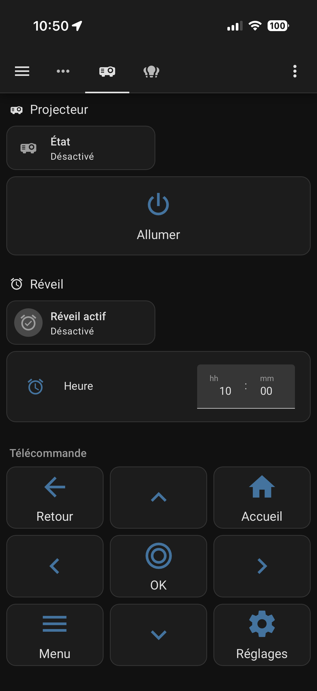
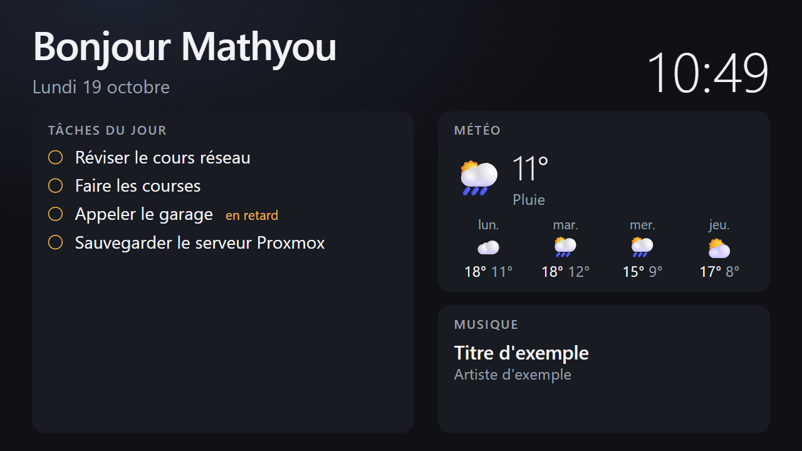

# Vidéoprojecteur Android TV piloté par SSH, ADB et Home Assistant

Prendre le contrôle d'un vidéoprojecteur sous Android TV depuis le réseau local :
un shell par SSH (Termux), des commandes système par ADB, puis une télécommande
dans Home Assistant.

Matériel testé : vidéoprojecteur à launcher HTC « LuminaOS » (`com.htc.luminaos`),
base Android TV 14 identifiée comme `ADT-3` (fabricant `askey`).

## Architecture

```
PC Windows ──SSH :8022──▶ Termux (utilisateur u0_a97, sans privilèges)
PC Windows ──ADB :5555──▶ adbd (utilisateur shell : touches, apps, réglages)
Home Assistant ──ADB :5555──▶ adbd (intégration « Android Debug Bridge »)
```

- **SSH (Termux)** : un shell d'application. Pratique pour lancer des activités
  (`am start`), mais pas de droits système (`settings`, `dumpsys` refusés).
- **ADB** : l'utilisateur `shell` peut simuler les touches de la télécommande,
  lancer des apps, lire l'état (`dumpsys`) et faire des captures d'écran.

## 1. SSH vers Termux

Sur le projecteur, dans Termux :

```bash
pkg install openssh
passwd
sshd
```

Sur le PC, copier la clé publique une fois (mot de passe Termux demandé) :

```powershell
type $env:USERPROFILE\.ssh\id_ed25519.pub | ssh -p 8022 u0_a97@<IP_PROJECTEUR> "mkdir -p ~/.ssh && cat >> ~/.ssh/authorized_keys && chmod 600 ~/.ssh/authorized_keys"
```

Alias dans `~/.ssh/config` :

```
Host projecteur
    HostName <IP_PROJECTEUR>
    Port 8022
    User u0_a97
    IdentityFile ~/.ssh/id_ed25519
```

Ensuite : `ssh projecteur`.

L'utilisateur Termux (`u0_aNN`) varie selon l'appareil : `whoami` dans Termux le donne.

## 2. ADB depuis le PC

Activer « Débogage USB » dans les options pour les développeurs, puis :

```powershell
adb connect <IP_PROJECTEUR>:5555
adb devices
```

La première fois, accepter la fenêtre « Autoriser le débogage USB ? » sur
l'écran du projecteur en cochant « Toujours autoriser ».

### Commandes utiles

| Action | Commande |
| --- | --- |
| Accueil | `adb shell input keyevent KEYCODE_HOME` |
| Retour | `adb shell input keyevent KEYCODE_BACK` |
| Volume + / − | `adb shell input keyevent KEYCODE_VOLUME_UP` / `KEYCODE_VOLUME_DOWN` |
| Arrêt complet (pas une veille sur ce modèle) | `adb shell input keyevent KEYCODE_POWER` |
| Paramètres | `adb shell am start -n com.android.tv.settings/.MainSettings` |
| App au premier plan | `adb shell "dumpsys window \| grep mCurrentFocus"` |
| État d'éveil | `adb shell "dumpsys power \| grep mWakefulness"` |

Sur ce launcher, l'intent standard `android.settings.SETTINGS` ne se résout pas :
il faut passer par le composant `com.android.tv.settings/.MainSettings`.

Capture d'écran : à faire depuis **bash**. Une redirection PowerShell corrompt le PNG.

```bash
adb exec-out screencap -p > ecran.png
```

## 3. Home Assistant

Intégration native **Android Debug Bridge** (`androidtv`) :
Paramètres → Appareils et services → Ajouter → « Android Debug Bridge »,
hôte `<IP_PROJECTEUR>`, port `5555`, classe « Android TV ».

Elle crée :

- `media_player.*` : état, volume, apps ;
- `remote.*` : touches de télécommande via `remote.send_command`.

```yaml
action: remote.send_command
target:
  entity_id: remote.videoprojecteur
data:
  command: HOME
```

Commandes arbitraires :

```yaml
action: androidtv.adb_command
target:
  entity_id: media_player.videoprojecteur
data:
  command: "am start -n com.android.tv.settings/.MainSettings"
```

### Carte télécommande



Un onglet dédié « Projecteur » du dashboard téléphone (`/tel-lumieres/projecteur`) regroupe :

- les flèches, OK, Accueil, Retour et Menu ;
- volume −, muet et volume + ;
- des raccourcis vers Netflix, YouTube, Prime Video et les Réglages ;
- Allumer et Éteindre.

Chaque bouton appelle `remote.send_command` ou `androidtv.adb_command`.

- **Allumer** passe par un émetteur infrarouge (Smart IR Tuya). Projecteur éteint, ADB ne répond plus.
- **Éteindre** envoie `POWER` avec une confirmation. Sur Android, `POWER` maintenu lance un arrêt complet, pas une veille.
- Ne pas utiliser `media_player.turn_on`/`turn_off` ni `remote.turn_on` : ils peuvent envoyer `POWER` et éteindre le projecteur.

### État allumé / éteint

Le `media_player` affiche toujours `off` : la bibliothèque `androidtv` lit mal
la sortie `dumpsys power` de ce modèle. Le vrai état est dans
`input_boolean.projecteur_allume`. Une automatisation le met à jour toutes les
10 s en testant `mWakefulness=Awake` par ADB.

L'intégration « Android TV Remote » de Google ne fonctionne pas ici : le service
de télécommande Google n'est pas installé sur ce launcher.

## 4. Page d'accueil à l'allumage



Quand le projecteur s'allume, il affiche une page « Bonjour Mathyou » avec :

- l'heure et la date ;
- la météo de Saint-Étienne (Met.no) ;
- les tâches du jour ;
- la musique en cours (Spotify).

La touche Retour la ferme.

Code dans [`accueil/`](accueil) :

- `server.py` : petit serveur Python, bibliothèque standard uniquement. Il sert la page et relaie trois
  lectures vers Home Assistant (`/api/data`, `/cover`). Le token HA reste sur le
  serveur, la page ne le voit jamais.
- `static/index.html` : la page (HTML/CSS/JS sans dépendance), dimensionnée en
  `vh` pour tenir sur l'écran du projecteur, rafraîchie chaque minute.
- `accueil-projecteur.service` : service systemd (utilisateur dynamique, système
  en lecture seule).

Les tâches du jour sont celles en retard, celles du jour et celles sans échéance.
La variable `TODO` liste les listes à lire, séparées par des virgules (Google Tasks, Todoist…).

### Déploiement (conteneur LXC Proxmox)

```bash
pct create <VMID> local:vztmpl/debian-13-standard_13.6-1_amd64.tar.zst --hostname scripts \
  --cores 1 --memory 256 --rootfs <STOCKAGE>:4 --unprivileged 1 --onboot 1 \
  --net0 name=eth0,bridge=vmbr0,ip=<IP_SERVEUR>/24,gw=<PASSERELLE>
```

Dans le conteneur :

- copier `server.py` et `static/` dans `/opt/accueil-projecteur/` ;
- copier le service dans `/etc/systemd/system/` ;
- créer `/etc/accueil-projecteur.env` (droits `600`) :

```
HA_URL=http://<IP_HA>:8123
HA_TOKEN=<token longue durée dédié>
PORT=8099
```

```bash
systemctl daemon-reload
systemctl enable --now accueil-projecteur
```

### Déclenchement

Le conteneur fait tourner un second service, `projecteur-watch`
(`projecteur-watch.sh` et `projecteur-watch.service`). Il interroge l'ADB du
projecteur toutes les 2 s. Quand le projecteur passe de « éteint/en veille » à
« éveillé », il ouvre la page dans le navigateur TCL. Il insiste jusqu'à 30 s,
car le launcher repasse parfois devant juste après le démarrage.

Le service a besoin d'une clé ADB déjà autorisée sur le projecteur, chargée en
credential systemd depuis `/etc/projecteur-watch/adbkey` (droits `600`).
L'adresse du projecteur et l'URL de la page se règlent par les variables `DEV`
et `URL` du service :

```bash
apt install adb
systemctl enable --now projecteur-watch
```

Délais mesurés (redémarrage du projecteur, `logcat`) :

| Méthode | Page affichée après le démarrage |
| --- | --- |
| Automatisation HA (suivi d'état toutes les 30 s + 10 s d'attente) | ~100 s |
| Script Termux au démarrage (`~/.termux/boot/`) | ~57 s |
| Service `projecteur-watch` (ADB toutes les 2 s) | ~45 s |

La limite vient du Wi-Fi du projecteur, connecté vers 38 s. Un script lancé sur
le projecteur lui-même ne peut pas faire mieux : sans root, aucun point
d'accroche n'existe avant `BOOT_COMPLETED`, que Termux reçoit vers 55 s.

Pourquoi une page auto-hébergée plutôt qu'un dashboard Home Assistant : le
navigateur du projecteur demandait une connexion HA. Ici, aucun identifiant
n'est stocké sur le projecteur.

## 5. Réveil

Dans l'onglet « Projecteur » du dashboard téléphone : interrupteur « Mode
réveil » (`input_boolean.reveil_actif`) et heure (`input_datetime.heure_de_reveil`).

« Mode réveil » s'active aussi à la voix : « Alexa, allume Mode réveil ».
L'entité est exposée à Alexa via Nabu Casa.

L'automatisation `reveil_heure_ha` a deux déclencheurs, relatifs à l'heure T :

| Moment | Action |
| --- | --- |
| T-1 min | `script.projecteur_reveil` allume le projecteur. `projecteur-watch` ouvre la page. `alexa_devices.send_text_command` demande à l'Echo « mets un réveil dans une minute » : vraie sonnerie Alexa, arrêt à la voix. |
| T+3 min | Si le projecteur est allumé, il s'éteint (`remote.send_command POWER`). |

Test réel : déclenchement à 00:38:00, projecteur allumé à 00:38:59, sonnerie à 00:39.

Pourquoi ne pas partir d'un réveil créé à la voix :

- le capteur « Prochaine alarme » de l'intégration Alexa ne s'est plus mis à jour ;
- les routines Alexa n'ont qu'un déclencheur « alarme ignorée » (à l'arrêt), pas
  « l'alarme sonne ».

Ne pas créer de routine Alexa « alarme ignorée → allumer le projecteur ». Elle
rallume le projecteur juste après qu'il s'est éteint, et le bouton infrarouge est
une bascule. Le script garde quand même une sécurité : pas de nouvel appui
infrarouge dans les 3 min qui suivent le précédent.

## Problèmes rencontrés et solutions

### Fenêtre d'autorisation ADB invisible

Le launcher `LuminaOS` passe devant la fenêtre système `UsbDebuggingActivity` :
elle s'ouvre mais reste invisible. adbd garde alors la demande « en attente »
et ignore toutes les suivantes. On le voit dans `logcat` :

```
adbd_auth: prompt currently pending, skipping
```

Solution : arrêter le client ADB à l'origine de la demande (ici le serveur ADB
lancé dans Termux, `adb kill-server`), puis redémarrer adbd. Pour ça,
désactiver puis réactiver le débogage dans les options pour les développeurs.

**À ne pas faire** : `settings put global adb_enabled 0` depuis une session ADB.
La commande coupe adbd, donc la session qui devait le réactiver. Il faut alors
réactiver le débogage à la main avec la télécommande.

### Home Assistant : `cannot_connect` (adbd en mode TLS)

Après réactivation par le menu du launcher, adbd répondait `STLS` au lieu de
`AUTH` : il exigeait TLS, réservé au « débogage sans fil » apparié. Le client
ADB Python de Home Assistant ne gère pas TLS.

Diagnostic : la propriété `persist.adb.tls_server.enable` vaut `1`.

```bash
adb shell getprop | grep -i adb
```

Correctif (depuis un client ADB déjà autorisé, comme le PC) :

```bash
adb shell setprop persist.adb.tls_server.enable 0
adb disconnect
adb kill-server
adb connect <IP_PROJECTEUR>:5555
```

adbd redémarre en ADB TCP classique et Home Assistant se connecte.

### Port 5555 après redémarrage

`persist.adb.tcp.port=5555` garde ADB réseau actif au démarrage. À vérifier
avec `adb shell getprop persist.adb.tcp.port`.

## Sécurité

- ADB réseau donne un accès `shell` complet au projecteur. Ne jamais exposer le
  port 5555 hors du réseau local (pas de redirection de port sur la box).
- Les clés autorisées sont listées sur l'appareil. Révoquer tout via Options pour
  les développeurs → « Révoquer les autorisations de débogage USB ».
- SSH Termux par clé uniquement. Une fois la clé copiée, le mot de passe peut
  être désactivé (`PasswordAuthentication no` dans
  `$PREFIX/etc/ssh/sshd_config`).

## Limites connues

- `media_player` reste `off` sur ce modèle. L'état réel vient de l'`input_boolean`, avec jusqu'à 10 s de retard.
- Projecteur éteint, ADB ne répond plus : l'allumage passe par l'infrarouge.
- L'IP du projecteur vient du DHCP. Réserver l'adresse dans la box si possible.
